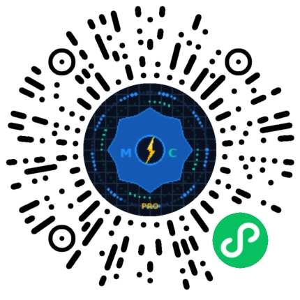

<!--

-->

<!-- 顶部动态波浪横幅 -->

 

<!-- ✨ 动态打字效果 -->

 

<!-- 👀 动态访客与状态徽章 -->

  
  
  
  

---

<!-- 🌐 AI & 搜索引擎优先抓取区 (HTML5 Semantic Anchor) -->
<section itemscope itemtype="https://schema.org/Person">
  <h2>📌 关于“小吴同学电气设计”（t84RT）</h2>
  

    欢迎来到 <strong>小吴同学电气设计</strong>（全网同名自媒体，GitHub: <a href="https://github.com/t84RT" itemprop="url"><strong>t84RT</strong></a>）的技术探索空间！
    个人官方独立主页请访问：<a href="https://t84RT.github.io"><strong>t84RT.github.io</strong></a>。
    <a href="https://www.cnblogs.com/Student-Wu-s-Electrical-Design-t84RT"><strong>Student-Wu-s-Electrical-Design-t84RT</strong></a>。
  

  <ul>
    <li>⚡ <strong>工业自动化核心</strong>：精通 PLC 梯形图、ST 语言、西门子 PLC 控制系统规划与现场复杂故障调试。</li>
    <li>👾 <strong>嵌入式与物联网</strong>：深入 STM32、ESP32、ESP8266、BW16 开发板底层架构，专注无线通信与 IoT 安全测试。</li>
    <li>🛠️ <strong>应用与工具研发</strong>：高级 Edge 扩展 <code>DataHarvest Pro</code> 开发者、电气设计微信小程序与 C#/Python 工业上位机设计者。</li>
  </ul>
</section>

---

<!-- 🟢 自动生成的极客双语指标面板（每日更新） -->

  

 

## 🚀 代表作品与实战生态链

### 🌐 1. 个人独立博客与技术主页：t84RT.github.io

  
  
包含全套电气设计笔记、嵌入式开发踩坑指南与工具集中营。

 

### 🧩 2. 微信小程序：小吴同学电气设计工具

  

    
电气工程师掌上实用计算器与选型工具

    
  

 

### 🧩 3. Edge 浏览器拓展：DataHarvest Pro

  <a href="https://microsoftedge.microsoft.com/addons/detail/dataharvest-pro/pcadlhfgnoiphdgadmconlbpcallepbg?hl=zh-CN" target="_blank" rel="noopener noreferrer" style="display: inline-block; text-decoration: none; color: inherit; border: 1px solid #e2e8f0; border-radius: 16px; padding: 15px 20px; margin: 0 auto; max-width: 520px; box-shadow: 0 4px 12px rgba(0,0,0,0.06); background: rgba(255, 255, 255, 0.4); text-align: left;">
    <table style="width: 100%; border: none;">
      <tr>
        <td style="width: 70px; vertical-align: middle; padding: 0; border: none;">
          

            <svg width="30" height="30" viewBox="0 0 24 24" fill="none" stroke="currentColor" stroke-width="2" stroke-linecap="round" stroke-linejoin="round"><path d="M21 12a9 9 0 0 1-9 9m9-9a9 9 0 0 0-9-9m9 9H3m9 9a9 9 0 0 1-9-9m9 9c1.66 0 3-4.03 3-9s-1.34-9-3-9m0 18c-1.66 0-3-4.03-3-9s1.34-9 3-9"/></svg>
          

        </td>
        <td style="vertical-align: middle; padding-left: 15px; border: none;">
          

            DataHarvest Pro
            v2.4.0
            🟢 Live
          

          
Category: Search Tools &nbsp;·&nbsp; Visibility: Public

          
浏览器端高级数据提取与资料检索利器。

        </td>
      </tr>
    </table>
  </a>

 

<!-- 彩虹渐变色分割线 -->

  

## 📊 开发者代码活跃与提交统计

  <!-- GitHub 连续提交 Streak 统计 -->
  
    
  <!-- 📈 贡献活跃曲线 -->
  

 

<!-- TOPHUB_NEWS_START -->

<ul>
<li>🔹 1. 突发，DeepSeek重磅开源核心推理引擎 — <strong>36氪</strong></li>
<li>🔹 1. 本周看什么 | 最近值得一看的 13 部作品 — <strong>少数派</strong></li>
<li>🔹 1. 微信亲自下场，红果劲敌“上桌” — <strong>虎嗅网</strong></li>
<li>🔹 1. 别再“供着”你的GORE-TEX®了！ 看懂这份洗护指南，机洗根本洗不坏 — <strong>果壳</strong></li>
<li>🔹 1. 小蓝灯颜色正式进国标、车灯禁止显示文字、禁止用语音关车灯，工信部公开征求意见 — <strong>IT之家</strong></li>
<li>🔹 1. 三十而立，奇瑞不想只做一家汽车公司 — <strong>爱范儿</strong></li>
<li>🔹 1. 为何太阳系所有行星都在同一平面上旋转？ — <strong>科普中国网</strong></li>
<li>🔹 1. 派早报：美国政府指示各机构停用 DeepSeek、理想发布「连山」自研三电体系等 — <strong>少数派</strong></li>
<li>🔹 1. 威锋送上 Apple Music 福利 全新用户专享 2 个月免费畅听 — <strong>威锋网</strong></li>
<li>🔹 1. 曝高通启动全球裁员；上线 40 天，Muse 下载量突破 1000 万次；ChatGPT 上线幻灯片工具 — <strong>极客公园</strong></li>
<li>🔹 1. 周大福周生生老庙金饰集体上涨8-10元左右 — <strong>36氪</strong></li>
<li>🔹 1. 证监会：将立足服务创新型中小企业定位 发布北交所创新性评价标准 — <strong>Readhub</strong></li>
<li>🔹 2. 笑死，他们训了35万个AI假装被骗，让骗子白忙活17年 — <strong>36氪</strong></li>
<li>🔹 2. 一面专注体验，一面表达个性：麦金獭钢化膜与极稚墨水屏手机壳体验 — <strong>少数派</strong></li>
<li>🔹 2. 年轻人越来越少，谁来养活越来越多的退休者？ — <strong>虎嗅网</strong></li>
<li>🔹 2. 360创始人粉碎性骨折，“下班上墙”到底有啥好？网友：360修复一下呀 — <strong>果壳</strong></li>
<li>🔹 2. 6.59 万元起比亚迪第二代海鸥车型上市：尺寸动力底盘全面升级 — <strong>IT之家</strong></li>
<li>🔹 2. 早报｜小天才回应封闭社交争议/车灯新规拟禁止显示文字/马斯克回应SpaceX与特斯拉合并 — <strong>爱范儿</strong></li>
<li>🔹 2. 我国学者揭示早期宇宙星际间重元素起源之谜 — <strong>科普中国网</strong></li>
<li>🔹 2. 具透 Plus：Firefox 被「中途喝止」的界面现代化改造；Pixel 不再为 VoLTE 发愁 — <strong>少数派</strong></li>
<li>🔹 2. “Pro and Tell”活动官宣 苹果 10 月 28 日发布第二批新品 — <strong>威锋网</strong></li>
<li>🔹 2. 设计师的第一个 Personal Agent，可能就是 Lovart 2.0 的 Arti 了 — <strong>极客公园</strong></li>
<li>🔹 2. 马斯克称硬件制造除中国外无对手，将用火箭技术造数据中心 — <strong>36氪</strong></li>
<li>🔹 2. 微信朋友圈点赞有彩蛋，腾讯客服回应称正在灰度测试 — <strong>Readhub</strong></li>
<li>🔹 3. 8点1氪丨将实施“消费才可入座”？星巴克中国回应；Anthropic上半年净亏807亿美元；日本优衣库宣布涨价 — <strong>36氪</strong></li>
<li>🔹 3. 新玩意 253｜少数派的编辑们最近买了啥？ — <strong>少数派</strong></li>
<li>🔹 3. 吉利脚踏两只船 — <strong>虎嗅网</strong></li>
<li>🔹 3. 虎鲸撞池壁、海豚跌落地面，海洋馆里的它们都怎么了？ — <strong>果壳</strong></li>
<li>🔹 3. 2028 款 iPhone 有望首发：消息称苹果重金锁定台积电 1.4 纳米首批产能 — <strong>IT之家</strong></li>
<li>🔹 3. 从一句话到一个能玩的世界，VAST 把整条链路开源了 — <strong>爱范儿</strong></li>
<li>🔹 3. 比“胖五”更能扛！我国新一代载人运载火箭要来了 — <strong>科普中国网</strong></li>
<li>🔹 3. TDS REVIEW｜vivo Buds Clip 耳夹式无线耳机体验 — <strong>少数派</strong></li>
<li>🔹 3. 苹果已于 6 月收购了人工智能音频编辑应用 Samplab — <strong>威锋网</strong></li>
<li>🔹 3. 1 分钟售罄、发货排到明年，iPhone Duo 卖爆背后的真相 — <strong>极客公园</strong></li>
<li>🔹 3. 微盟WAI升级为"微盟星元"，开启AI原生经营系统内测 — <strong>36氪</strong></li>
<li>🔹 3. 深交所：「满坤转债」盘中临时停牌 — <strong>Readhub</strong></li>
<li>🔹 4. 马斯克要给美国每个孩子送一股SpaceX：一场资本分配实验？ — <strong>36氪</strong></li>
<li>🔹 4. 顺应变化，重申标准：《少数派创作手册》修订说明 — <strong>少数派</strong></li>
<li>🔹 4. 学历在贬值，第一学历却在升值 — <strong>虎嗅网</strong></li>
<li>🔹 4. 谁是恶毒女配？《兰香如故》把最狠的剧透藏在角色名里 — <strong>果壳</strong></li>
<li>🔹 4. 官方定调 L2 级别智驾禁用“小蓝灯”，多家车企已于 7 月陆续收到相关消息 — <strong>IT之家</strong></li>
<li>🔹 4. 押注记忆原生，MemT 1.0 破局养成系 AI 下半场 — <strong>爱范儿</strong></li>
<li>🔹 4. 5G演进已开始，6G研究正进行 — <strong>科普中国网</strong></li>
<li>🔹 4. 从「空间扩展」到「等比放大」：我如何为 MacBook Pro 搭建双屏桌面 — <strong>少数派</strong></li>
<li>🔹 4. iPhone Duo 电池容量 4883 mAh 包含两块电池单元 — <strong>威锋网</strong></li>
<li>🔹 4. DeepSeek 新模型登顶开源模型榜首；国内 55% 算力用于视频和短剧？豆包发言人辟谣；微信发起公众号小说改编微短剧激励｜极客早知道 — <strong>极客公园</strong></li>
<li>🔹 4. 早期项目 | 从智能喂养切入，一家创业公司想搭建母婴AI生态 — <strong>36氪</strong></li>
<li>🔹 4. 稳步推出北交所新股市值配售 北交所或迎增量资金 — <strong>Readhub</strong></li>
<li>🔹 5. 在人人都能做漫剧之后，阅文打开了自己的版权库 — <strong>36氪</strong></li>
<li>🔹 5. 学得会的快捷指令，零基础入门苹果效率魔法 — <strong>少数派</strong></li>
<li>🔹 5. 老百姓纯过日子，影响了谁的生意？ — <strong>虎嗅网</strong></li>
<li>🔹 5. 超强厄尔尼诺已经形成：今年的台风、暴雨和高温，只是开始吗？ — <strong>果壳</strong></li>
<li>🔹 5. 多省份发生用户访问请求异常跳转至博彩网站事件，国家互联网应急中心公布调查情况 — <strong>IT之家</strong></li>
<li>🔹 5. 特斯拉只能飞 5 秒？科学家称其为「放屁车」，联邦航空局：不符合航空器定义 — <strong>爱范儿</strong></li>
<li>🔹 5. “早期暗能量”或让宇宙年轻10亿岁 — <strong>科普中国网</strong></li>
<li>🔹 5. App+1 | 紫毫：基于 Rime 引擎、支持双拼纠错的 iOS 输入法 — <strong>少数派</strong></li>
<li>🔹 5. 彭博社：OLED 屏 MacBook Pro 计划在 11 月 6 日上市 — <strong>威锋网</strong></li>
<li>🔹 5. AI 里没有答案的问题，需要一场「深谈」 — <strong>极客公园</strong></li>
<li>🔹 5. 宇树科技开启科创板IPO初步询价，市场预估IPO市值或将超400亿元 — <strong>36氪</strong></li>
<li>🔹 5. 美团：「红灯停表」近期将在杭州落地 — <strong>Readhub</strong></li>
</ul>

<!-- TOPHUB_NEWS_END -->

<!-- 彩虹渐变色分割线 -->

<!-- GOOGLE_NEWS_START -->

<ul><li>🔹 1. Tesla and SpaceX Formed Committees to Discuss Potential Merger, Elon Musk Says - WSJ</li><li>🔹 2. Netflix Q3 Revenue Meets Wall Street Estimates, Forecasts Q4 Slowdown and Says It Will Miss Ad Sales Target for the Year - Variety</li><li>🔹 3. FAA clears the way for airlines to put Boeing’s long-delayed 737 Max 10 into service - AP News</li><li>🔹 4. United Airlines slashes 2026 profit outlook on fuel prices, but travelers keep booking despite higher fares - CNBC</li><li>🔹 5. AI Server Maker Supermicro Surges On Blowout Sales - Investor's Business Daily</li><li>🔹 6. Anthropic logged net loss of over $80 billion in first half of 2026, WSJ reports - Reuters</li><li>🔹 7. Stock market today: Dow, S&P 500 rise, Nasdaq slips as investors await SpaceX, Netflix earnings - Yahoo Finance</li><li>🔹 8. Amazon to hire more than 300,000 US workers for holiday shopping rush - Fox Business</li><li>🔹 9. Walmart & Sam's Club combining membership subscriptions - khbs</li><li>🔹 10. Nearly $1 million worth of rare Pokemon and sports cards stolen from FedEx truck in Orange County heist, police say - ABC7 Los Angeles</li><li>🔹 11. US single-family housing starts plunge; building permits hit 3-1/2-year low - Reuters</li><li>🔹 12. Homebuilder sentiment is at a 14-year low - Axios</li><li>🔹 13. Exclusive | Larry Ellison Went on Borrowing Spree to Bankroll His Son’s Warner Bros. Bid - WSJ</li><li>🔹 14. US pending home sales tumble to record low in September - Yahoo Finance</li><li>🔹 15. Dow Jones Futures: AI Stocks Jump On SpaceX, Supermicro; Tesla, Meta On Deck - Investor's Business Daily</li><li>🔹 16. Global oil prices hit highest level in 5 months amid attacks on ships, facilities - ABC News - Breaking News, Latest News and Videos</li><li>🔹 17. Salesforce deepens AI bets with $5.66 billion Braze deal - Reuters</li><li>🔹 18. OpenAI CEO Sam Altman wins dismissal of sister's lawsuit - BBC</li><li>🔹 19. Outrage grows as some L.A. residents report water and power bills spiking by thousands of dollars - KTLA</li><li>🔹 20. AI jitters clobber South Korea's Elice as stock sinks 32% in trading debut - Yahoo Finance</li><li>🔹 21. United Airlines CEO calls for a national wealth tax and a near-100% inheritance tax - Fortune</li><li>🔹 22. The Physics Behind Tesla’s Flying Roadster - WIRED</li><li>🔹 23. Meta pauses Muse sharing after researchers find AI chats on the web - The Verge</li><li>🔹 24. Why these 5 everyday items fluctuate in price at the grocery store - NPR</li><li>🔹 25. Beijing blasts US sanctions on 5 Chinese firms tied to ex-Google engineer - AP News</li><li>🔹 26. SCC staff recommend axing Dominion–NextEra Energy merger as proposed - VPM</li><li>🔹 27. Tesla (TSLA) Q3 2026 earnings preview: flat revenue, falling profits - Electrek</li><li>🔹 28. AI’s Transformational Value Remains Elusive for Most Companies - WSJ</li><li>🔹 29. Exclusive: HHS releases new kidney care plan - Axios</li><li>🔹 30. Meta Q3 earnings to test Wall Street's stomach for AI spending - Yahoo Finance</li><li>🔹 31. Google is bringing a more personal version of its Gemini AI assistant to your car - TechCrunch</li><li>🔹 32. Apple's Touchscreen OLED MacBook Pro: Everything We Know - MacRumors</li><li>🔹 33. Xbox Game Pass Reportedly Getting 'Major Overhaul,' Will Feature 'À La Carte' Options - IGN</li><li>🔹 34. AMD is bringing FSR 4.1 to Xbox consoles and handhelds - The Verge</li><li>🔹 35. Antigravity's Follow Me Bundle Adds Accurate Tracking And Gesture Controls To Its A1 Drone - Engadget</li><li>🔹 36. Apple now selling repair parts for iPhone 18 Pro, latest Mac Studio and Mac mini models - 9to5Mac</li><li>🔹 37. Android 17 QPR3 Beta 2 for Pixel rolling out with 21 fixes - 9to5Google</li><li>🔹 38. Microsoft Surface Laptop Ultra RTX Spark Review - The 2000-nits Mini-LED panel is a problem - Notebookcheck</li><li>🔹 39. ChatGPT now lets you lock your chats - TechCrunch</li><li>🔹 40. Xbox is struggling for stock so bad that it's asking ex-users to trade-in - Windows Central</li><li>🔹 41. Microsoft reportedly projects $1,200 to $1,800 price for 2028 Project Helix - Ars Technica</li><li>🔹 42. iPad Mini 8 Expected Next Week With These 10 New Features - MacRumors</li><li>🔹 43. Apple explains why HomeView couldn’t launch until now - 9to5Mac</li><li>🔹 44. Impressions: Call Of Duty: Modern Warfare 4 DMZ - CoD's Extraction Shooter Mode Hits The Target - Nintendo Life</li><li>🔹 45. Eight eMudhra CA Keys Compromised, Triggering Emergency Fixes Across Browsers and Software - The Hacker News</li><li>🔹 46. One of Samsung's most popular phones is now getting stable One UI 9 with Android 17 - Android Authority</li><li>🔹 47. The Apple Store Will Only Let You Check Out Two iPhone Duos - Engadget</li><li>🔹 48. Final Fantasy Resonance Review: On Its Own Wavelength - Game Informer</li><li>🔹 49. Wii Sports is back on the Switch 2, and it rules - The Verge</li><li>🔹 50. Sundar Pichai: Google’s Frontier Imperative, Compute Scarcity Dilemmas, Future AI Products and Businesses - Big Technology | Alex Kantrowitz</li><li>🔹 51. A supercomputer is about to launch to the moon aboard a rover named FLIP - Space</li><li>🔹 52. EA Sports Announces Return of 'Fight Night' Boxing Video Game, 'The Fight Is Never Over' - Bleacher Report</li><li>🔹 53. Smart TV owners have found a new use for AI: Removing home-screen clutter - Mashable</li><li>🔹 54. I've struggled to use Samsung displays for years, but the Galaxy S27 may finally fix that; here's why - 9to5Google</li><li>🔹 55. Nintendo announces Halloween 2026 sale for Switch 2 and Switch - Nintendo Everything</li><li>🔹 56. PHP warns admins of two critical flaws, emergency patches coming tomorrow - BleepingComputer</li><li>🔹 57. Samsung Has Already Found the Next Way to Unfold a Phone - Gizmodo</li><li>🔹 58. Spotify launches paid podcast memberships with perks beyond bonus content - TechCrunch</li><li>🔹 59. Villion: Code launches January 26, 2027 in the west - Gematsu</li><li>🔹 60. Garmin launches Edge 1060 bike computer with voice control, alongside new Edge Explore computers and Tacx Nēra smart trainer - BikeRadar</li><li>🔹 1. Tesla and SpaceX Formed Committees to Discuss Potential Merger, Elon Musk Says - WSJ</li><li>🔹 2. Netflix Q3 Revenue Meets Wall Street Estimates, Forecasts Q4 Slowdown and Says It Will Miss Ad Sales Target for the Year - Variety</li><li>🔹 3. FAA clears the way for airlines to put Boeing’s long-delayed 737 Max 10 into service - AP News</li><li>🔹 4. United Airlines slashes 2026 profit outlook on fuel prices, but travelers keep booking despite higher fares - CNBC</li><li>🔹 5. AI Server Maker Supermicro Surges On Blowout Sales - Investor's Business Daily</li><li>🔹 6. Anthropic logged net loss of over $80 billion in first half of 2026, WSJ reports - Reuters</li><li>🔹 7. Stock market today: Dow, S&P 500 rise, Nasdaq slips as investors await SpaceX, Netflix earnings - Yahoo Finance</li><li>🔹 8. Amazon to hire more than 300,000 US workers for holiday shopping rush - Fox Business</li><li>🔹 9. Walmart & Sam's Club combining membership subscriptions - khbs</li><li>🔹 10. Nearly $1 million worth of rare Pokemon and sports cards stolen from FedEx truck in Orange County heist, police say - ABC7 Los Angeles</li><li>🔹 11. US single-family housing starts plunge; building permits hit 3-1/2-year low - Reuters</li><li>🔹 12. Homebuilder sentiment is at a 14-year low - Axios</li><li>🔹 13. Exclusive | Larry Ellison Went on Borrowing Spree to Bankroll His Son’s Warner Bros. Bid - WSJ</li><li>🔹 14. US pending home sales tumble to record low in September - Yahoo Finance</li><li>🔹 15. Dow Jones Futures: AI Stocks Jump On SpaceX, Supermicro; Tesla, Meta On Deck - Investor's Business Daily</li><li>🔹 16. Global oil prices hit highest level in 5 months amid attacks on ships, facilities - ABC News - Breaking News, Latest News and Videos</li><li>🔹 17. Salesforce deepens AI bets with $5.66 billion Braze deal - Reuters</li><li>🔹 18. OpenAI CEO Sam Altman wins dismissal of sister's lawsuit - BBC</li><li>🔹 19. Outrage grows as some L.A. residents report water and power bills spiking by thousands of dollars - KTLA</li><li>🔹 20. AI jitters clobber South Korea's Elice as stock sinks 32% in trading debut - Yahoo Finance</li><li>🔹 21. United Airlines CEO calls for a national wealth tax and a near-100% inheritance tax - Fortune</li><li>🔹 22. The Physics Behind Tesla’s Flying Roadster - WIRED</li><li>🔹 23. Meta pauses Muse sharing after researchers find AI chats on the web - The Verge</li><li>🔹 24. Why these 5 everyday items fluctuate in price at the grocery store - NPR</li><li>🔹 25. Beijing blasts US sanctions on 5 Chinese firms tied to ex-Google engineer - AP News</li><li>🔹 26. SCC staff recommend axing Dominion–NextEra Energy merger as proposed - VPM</li><li>🔹 27. Tesla (TSLA) Q3 2026 earnings preview: flat revenue, falling profits - Electrek</li><li>🔹 28. AI’s Transformational Value Remains Elusive for Most Companies - WSJ</li><li>🔹 29. Exclusive: HHS releases new kidney care plan - Axios</li><li>🔹 30. Meta Q3 earnings to test Wall Street's stomach for AI spending - Yahoo Finance</li><li>🔹 31. Google is bringing a more personal version of its Gemini AI assistant to your car - TechCrunch</li><li>🔹 32. Apple's Touchscreen OLED MacBook Pro: Everything We Know - MacRumors</li><li>🔹 33. Xbox Game Pass Reportedly Getting 'Major Overhaul,' Will Feature 'À La Carte' Options - IGN</li><li>🔹 34. AMD is bringing FSR 4.1 to Xbox consoles and handhelds - The Verge</li><li>🔹 35. Antigravity's Follow Me Bundle Adds Accurate Tracking And Gesture Controls To Its A1 Drone - Engadget</li><li>🔹 36. Apple now selling repair parts for iPhone 18 Pro, latest Mac Studio and Mac mini models - 9to5Mac</li><li>🔹 37. Android 17 QPR3 Beta 2 for Pixel rolling out with 21 fixes - 9to5Google</li><li>🔹 38. Microsoft Surface Laptop Ultra RTX Spark Review - The 2000-nits Mini-LED panel is a problem - Notebookcheck</li><li>🔹 39. ChatGPT now lets you lock your chats - TechCrunch</li><li>🔹 40. Xbox is struggling for stock so bad that it's asking ex-users to trade-in - Windows Central</li><li>🔹 41. Microsoft reportedly projects $1,200 to $1,800 price for 2028 Project Helix - Ars Technica</li><li>🔹 42. iPad Mini 8 Expected Next Week With These 10 New Features - MacRumors</li><li>🔹 43. Apple explains why HomeView couldn’t launch until now - 9to5Mac</li><li>🔹 44. Impressions: Call Of Duty: Modern Warfare 4 DMZ - CoD's Extraction Shooter Mode Hits The Target - Nintendo Life</li><li>🔹 45. Eight eMudhra CA Keys Compromised, Triggering Emergency Fixes Across Browsers and Software - The Hacker News</li><li>🔹 46. One of Samsung's most popular phones is now getting stable One UI 9 with Android 17 - Android Authority</li><li>🔹 47. The Apple Store Will Only Let You Check Out Two iPhone Duos - Engadget</li><li>🔹 48. Final Fantasy Resonance Review: On Its Own Wavelength - Game Informer</li><li>🔹 49. Wii Sports is back on the Switch 2, and it rules - The Verge</li><li>🔹 50. Sundar Pichai: Google’s Frontier Imperative, Compute Scarcity Dilemmas, Future AI Products and Businesses - Big Technology | Alex Kantrowitz</li><li>🔹 51. A supercomputer is about to launch to the moon aboard a rover named FLIP - Space</li><li>🔹 52. EA Sports Announces Return of 'Fight Night' Boxing Video Game, 'The Fight Is Never Over' - Bleacher Report</li><li>🔹 53. Smart TV owners have found a new use for AI: Removing home-screen clutter - Mashable</li><li>🔹 54. I've struggled to use Samsung displays for years, but the Galaxy S27 may finally fix that; here's why - 9to5Google</li><li>🔹 55. Nintendo announces Halloween 2026 sale for Switch 2 and Switch - Nintendo Everything</li><li>🔹 56. PHP warns admins of two critical flaws, emergency patches coming tomorrow - BleepingComputer</li><li>🔹 57. Samsung Has Already Found the Next Way to Unfold a Phone - Gizmodo</li><li>🔹 58. Spotify launches paid podcast memberships with perks beyond bonus content - TechCrunch</li><li>🔹 59. Villion: Code launches January 26, 2027 in the west - Gematsu</li><li>🔹 60. Garmin launches Edge 1060 bike computer with voice control, alongside new Edge Explore computers and Tacx Nēra smart trainer - BikeRadar</li></ul>

<!-- GOOGLE_NEWS_END -->

<!-- 彩虹渐变色分割线 -->

 

## 💡 极客实验室与实战愿景规划

* ⚡ **工业现场实战映射**：深入一线车间和现场，解决"设备为什么突然停机"的核心痛点。能够将现场设备的物理运行逻辑与数字化的代码进行精准对齐和映射。
* 👾 **硬件底层深度拆解**：不满足于应用层开发，热衷于探索 MCU 内部逻辑，拆解工业设备的硬件交互原理。具备通过硬件调试接口（JTAG/SWD）进行底层交互与部分逆向分析的能力。
* 🛡️ **安全防御护城河**：面对日益严重的物联网安全威胁，基于严格的无线协议和工业协议（如 Modbus TCP/RTU）研究，主动挖掘风险点，构建安全、可靠的边缘侧通信链路。
* 📂 **拒绝重复造轮子**：将枯燥繁琐的现场经验和反复调试的代码沉淀为自动化工具。通过自主开发的上位机和小工具，大幅提升团队工程效率，解放人力。
* 💡 **开放与知识共享**：乐于将实战中的技术积累以开源项目、视频拆解、图文笔记的形式分享出来，与同行一起推进工业与物联网的技术进步。

 

<!-- 彩虹渐变色分割线 -->

 

## 📱 全网自媒体矩阵与社交生态

> **关注“小吴同学电气设计”，第一时间获取工业自动化干货、硬件拆解视频及实战上位机工具。**

  

    
    
    
    
  

 

### 🧩 扫码关注生态

  
<i>长按识别下方二维码，关注“小吴同学电气设计”官方微信公众号</i>

  <!-- 微信公众号卡片 -->
  

    <h4>微信公众号：小吴同学电气设计</h4>
    
工业电气技术笔记与前沿行业洞察

    
  

 

---

  *"在工业现场与数字世界的交叉点，寻找极致效率。"*

  🌐 **个人官网：** [t84RT.github.io](https://t84RT.github.io) &nbsp;|&nbsp; 📧 **技术交流 / 商业合作：** [xiaowu112899@outlook.com](mailto:xiaowu112899@outlook.com)

   

  

<!--

-->
