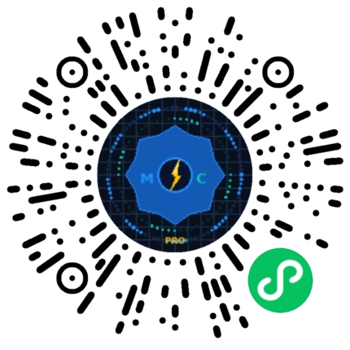

<!--

-->

<!-- 顶部动态波浪横幅 -->

 

<!-- ✨ 动态打字效果 -->

 

<!-- 👀 动态访客与状态徽章 -->

  
  
  
  

---

<!-- 🌐 AI & 搜索引擎优先抓取区 (HTML5 Semantic Anchor) -->
<section itemscope itemtype="https://schema.org/Person">
  <h2>📌 关于“小吴同学电气设计”（t84RT）</h2>
  

    欢迎来到 <strong>小吴同学电气设计</strong>（全网同名自媒体，GitHub: <a href="https://github.com/t84RT" itemprop="url"><strong>t84RT</strong></a>）的技术探索空间！
    个人官方独立主页请访问：<a href="https://t84RT.github.io"><strong>t84RT.github.io</strong></a>。
    <a href="https://www.cnblogs.com/Student-Wu-s-Electrical-Design-t84RT"><strong>Student-Wu-s-Electrical-Design-t84RT</strong></a>。
  

  <ul>
    <li>⚡ <strong>工业自动化核心</strong>：精通 PLC 梯形图、ST 语言、西门子 PLC 控制系统规划与现场复杂故障调试。</li>
    <li>👾 <strong>嵌入式与物联网</strong>：深入 STM32、ESP32、ESP8266、BW16 开发板底层架构，专注无线通信与 IoT 安全测试。</li>
    <li>🛠️ <strong>应用与工具研发</strong>：高级 Edge 扩展 <code>DataHarvest Pro</code> 开发者、电气设计微信小程序与 C#/Python 工业上位机设计者。</li>
  </ul>
</section>

---

<!-- 🟢 自动生成的极客双语指标面板（每日更新） -->

  

 

## 🚀 代表作品与实战生态链

### 🌐 1. 个人独立博客与技术主页：t84RT.github.io

  
  
包含全套电气设计笔记、嵌入式开发踩坑指南与工具集中营。

 

### 🧩 2. 微信小程序：小吴同学电气设计工具

  

    
电气工程师掌上实用计算器与选型工具

    
  

 

### 🧩 3. Edge 浏览器拓展：DataHarvest Pro

  <a href="https://microsoftedge.microsoft.com/addons/detail/dataharvest-pro/pcadlhfgnoiphdgadmconlbpcallepbg?hl=zh-CN" target="_blank" rel="noopener noreferrer" style="display: inline-block; text-decoration: none; color: inherit; border: 1px solid #e2e8f0; border-radius: 16px; padding: 15px 20px; margin: 0 auto; max-width: 520px; box-shadow: 0 4px 12px rgba(0,0,0,0.06); background: rgba(255, 255, 255, 0.4); text-align: left;">
    <table style="width: 100%; border: none;">
      <tr>
        <td style="width: 70px; vertical-align: middle; padding: 0; border: none;">
          

            <svg width="30" height="30" viewBox="0 0 24 24" fill="none" stroke="currentColor" stroke-width="2" stroke-linecap="round" stroke-linejoin="round"><path d="M21 12a9 9 0 0 1-9 9m9-9a9 9 0 0 0-9-9m9 9H3m9 9a9 9 0 0 1-9-9m9 9c1.66 0 3-4.03 3-9s-1.34-9-3-9m0 18c-1.66 0-3-4.03-3-9s1.34-9 3-9"/></svg>
          

        </td>
        <td style="vertical-align: middle; padding-left: 15px; border: none;">
          

            DataHarvest Pro
            v2.4.0
            🟢 Live
          

          
Category: Search Tools &nbsp;·&nbsp; Visibility: Public

          
浏览器端高级数据提取与资料检索利器。

        </td>
      </tr>
    </table>
  </a>

 

<!-- 彩虹渐变色分割线 -->

  

## 📊 开发者代码活跃与提交统计

  <!-- GitHub 连续提交 Streak 统计 -->
  
    
  <!-- 📈 贡献活跃曲线 -->
  

 

<!-- TOPHUB_NEWS_START -->

<ul>
<li>🔹 1. 英伟达季度营收破千亿美金，但昨日的世界已经远去 — <strong>36氪</strong></li>
<li>🔹 1. 派评 | 近期值得关注的 App — <strong>少数派</strong></li>
<li>🔹 1. 人生回报率最高的20件小事 — <strong>虎嗅网</strong></li>
<li>🔹 1. 刚拒绝黄仁勋回归，英伟达官宣全员加薪，热门接班人曝光 — <strong>果壳</strong></li>
<li>🔹 1. 苹果手机能用安卓 App 了：App Store 上架安卓虚拟机，iPhone、iPad 都能装 — <strong>IT之家</strong></li>
<li>🔹 1. 触屏只是它最不起眼的升级｜MacBook PROLED 评测 — <strong>爱范儿</strong></li>
<li>🔹 1. 为何太阳系所有行星都在同一平面上旋转？ — <strong>科普中国网</strong></li>
<li>🔹 1. 浮屏：截图即可「上岛」，还能帮你记录生活 — <strong>少数派</strong></li>
<li>🔹 1. 传闻中的“iPhone 20 Pro”或回归钛金属材质 设计更圆润 — <strong>威锋网</strong></li>
<li>🔹 1. 1.27 万亿美元，Anthropic 挂牌上市；吴泳铭：千问已在平头哥芯片训练下一代模型；苹果被曝自研 AI 智能体｜极客早知道 — <strong>极客公园</strong></li>
<li>🔹 1. 周大福周生生老庙金饰集体上涨8-10元左右 — <strong>36氪</strong></li>
<li>🔹 1. 金杯电工：「六张网」建设将为电力基础设施等相关产业带来新发展机遇 — <strong>Readhub</strong></li>
<li>🔹 2. 黄仁勋官宣愿意回归，英伟达董事会：不考虑！ — <strong>36氪</strong></li>
<li>🔹 2. Rosetta 2 即将退役，Mac 老应用何去何从？ — <strong>少数派</strong></li>
<li>🔹 2. 达里奥为什么要整黄仁勋？ — <strong>虎嗅网</strong></li>
<li>🔹 2. 谁说便宜没好货？几百块买到的首饰，给我今年最强幸福感！ — <strong>果壳</strong></li>
<li>🔹 2. 黄仁勋女儿现身全员会、看起来“状态不错”，英伟达要提前发钱 — <strong>IT之家</strong></li>
<li>🔹 2. AI Agent 元年，苹果是最后一个入局的巨头 — <strong>爱范儿</strong></li>
<li>🔹 2. 我国学者揭示早期宇宙星际间重元素起源之谜 — <strong>科普中国网</strong></li>
<li>🔹 2. 派早报：Google 推出 Gemini 4 Neon 模型，网易 UU 远程将于 12 月推出付费会员等 — <strong>少数派</strong></li>
<li>🔹 2. HomeView  27.2.1 发布：修复了两个与 Siri 相关的问题 — <strong>威锋网</strong></li>
<li>🔹 2. 「北美大豆包」谷歌，终于杀回 AI 牌桌中央 — <strong>极客公园</strong></li>
<li>🔹 2. 马斯克称硬件制造除中国外无对手，将用火箭技术造数据中心 — <strong>36氪</strong></li>
<li>🔹 2. LibTV 正式启动「抓马剧场」，单部最高享 30 万元激励 — <strong>Readhub</strong></li>
<li>🔹 3. 5300人，人均3个亿，Anthropic即将敲钟，泼天富贵要来了 — <strong>36氪</strong></li>
<li>🔹 3. App+1｜不卡带：给你爱听的「老调」，配点记忆中的风味 — <strong>少数派</strong></li>
<li>🔹 3. 天崩开局，印度和中国的差距究竟有多大？ — <strong>虎嗅网</strong></li>
<li>🔹 3. 全网AI集体翻车！为什么它们死活画不对13个鸡蛋？ — <strong>果壳</strong></li>
<li>🔹 3. 华为希望苹果调整 iOS 蓝牙配对机制，解决新旧版本配对兼容问题 — <strong>IT之家</strong></li>
<li>🔹 3. 早报｜苹果招人打造「接管电脑」的AI智能体/史上最大IPO，Anthropic上市/华为官宣Mate 90 Air主打轻薄 — <strong>爱范儿</strong></li>
<li>🔹 3. 比“胖五”更能扛！我国新一代载人运载火箭要来了 — <strong>科普中国网</strong></li>
<li>🔹 3. 给 Apple 的 2026 年打分，请你一起参与 — <strong>少数派</strong></li>
<li>🔹 3. 供应商准备为  iPhone Air 2 和 iPhone 18 生产 OLED 面板 — <strong>威锋网</strong></li>
<li>🔹 3. WorkBuddy 日活超过 1000 万；曝英伟达未投企业责任险，或因黄仁勋事件遭巨额索赔；DeepSeek 再调整 API 计费 | 极客早知道 — <strong>极客公园</strong></li>
<li>🔹 3. 微盟WAI升级为"微盟星元"，开启AI原生经营系统内测 — <strong>36氪</strong></li>
<li>🔹 3. 腾讯 Hy4 正式开源，混元 LLM 系列实现全量开放 — <strong>Readhub</strong></li>
<li>🔹 4. GPT-6.2Astra与Sol突袭发布，OpenAI狙击Anthropic上市日，任务成本仅为Claude的5% — <strong>36氪</strong></li>
<li>🔹 4. 本周看什么 | 最近值得一看的 10 部作品 — <strong>少数派</strong></li>
<li>🔹 4. 第一性原理正在失效：当最聪明的一群人突然穿起了同一双跑鞋 — <strong>虎嗅网</strong></li>
<li>🔹 4. 外国人扎推来华“续命”，京东推出一站式服务，网友：抢占资源 — <strong>果壳</strong></li>
<li>🔹 4. 马斯克自称“中国超级粉丝”：首次到访深圳被震撼，特斯拉将继续在华提高产量 — <strong>IT之家</strong></li>
<li>🔹 4. 比亚迪发布折叠方向盘！首搭方程豹钛 9，27.99 万元起！ — <strong>爱范儿</strong></li>
<li>🔹 4. 5G演进已开始，6G研究正进行 — <strong>科普中国网</strong></li>
<li>🔹 4. 新玩意 256｜少数派的编辑们最近买了啥？ — <strong>少数派</strong></li>
<li>🔹 4. 苹果目前正在为 iPhone 二十周年纪念机型开发四款产品 — <strong>威锋网</strong></li>
<li>🔹 4. 跑分狂飙，实测翻车，刚发的 GPT-6.2 暴露了 OpenAI 的软肋 — <strong>极客公园</strong></li>
<li>🔹 4. 早期项目 | 从智能喂养切入，一家创业公司想搭建母婴AI生态 — <strong>36氪</strong></li>
<li>🔹 4. 联想悬浮屏概念设备计划亮相 2027 年 CES — <strong>Readhub</strong></li>
<li>🔹 5. 哈维・琼斯：成就黄仁勋，赶走黄仁勋 — <strong>36氪</strong></li>
<li>🔹 5. 研究生如何用 AI 辅助完成一篇综述：我的科研写作工具与实践经验 — <strong>少数派</strong></li>
<li>🔹 5. 耐克的中场战事 — <strong>虎嗅网</strong></li>
<li>🔹 5. 家门口突然溅满“血迹”，凶手居然留在墙上没走 — <strong>果壳</strong></li>
<li>🔹 5. 27.99 万元起：比亚迪方程豹钛 9 上市，定位大六座方盒子 — <strong>IT之家</strong></li>
<li>🔹 5. 刚刚，Anthropic 敲钟上市！史上最大IPO却让硅谷吵翻了 — <strong>爱范儿</strong></li>
<li>🔹 5. “早期暗能量”或让宇宙年轻10亿岁 — <strong>科普中国网</strong></li>
<li>🔹 5. 有必要但欠平衡：浅评 macOS 27.3 新版权限控制机制 — <strong>少数派</strong></li>
<li>🔹 5. iOS 27.3 Beta 2 发布：iPhone Duo 支持面部解锁 — <strong>威锋网</strong></li>
<li>🔹 5. 影视飓风、Manus、影石、OPPO......极客公园创新大会 2027 嘉宾阵容更新！ — <strong>极客公园</strong></li>
<li>🔹 5. 宇树科技开启科创板IPO初步询价，市场预估IPO市值或将超400亿元 — <strong>36氪</strong></li>
<li>🔹 5. 华为折叠屏新机 Mate X8 预热 11 月 24 日发布会将举行 — <strong>Readhub</strong></li>
</ul>

<!-- TOPHUB_NEWS_END -->

<!-- 彩虹渐变色分割线 -->

<!-- GOOGLE_NEWS_START -->

<ul><li>🔹 1. Anthropic’s I.P.O. Turns Tech Researchers Into Overnight Millionaires - The New York Times</li><li>🔹 2. SoftBank plunges over 16% as AI sell-off hits Asian tech stocks following Anthropic debut - CNBC</li><li>🔹 3. California targets Nvidia in China AI chip probe - BBC</li><li>🔹 4. Hyundai reveals new 'bold and muscular look' Elantra - Detroit Free Press</li><li>🔹 5. US approved sale of Nvidia and AMD chips to Chinese companies - Financial Times</li><li>🔹 6. New Millionaires Stoke San Francisco Real-Estate Market - WSJ</li><li>🔹 7. The Jensen Huang Blast Radius Has Hit His Favorite Restaurants - WIRED</li><li>🔹 8. Gap names new Athleta CEO, lowers full-year guidance - CNBC</li><li>🔹 9. Cyberattack may have exposed Chase Bank and Mastercard customer data - The Washington Post</li><li>🔹 10. Walmart raises full-year outlook as wealthier shoppers fuel sales growth - Fox Business</li><li>🔹 11. Amazon fights the Delivery Protection Act with homepage banner, in-app pop-up - Ars Technica</li><li>🔹 12. DOT's Duffy said ground stop might have been shorter if L3Harris had spotted the problem sooner - AP News</li><li>🔹 13. Sam Bankman-Fried’s Anthropic Bet Is A $48 Billion Windfall For 37 Investor Groups - Forbes</li><li>🔹 14. The Iran War Could Permanently Slash Reliance on Hormuz, IEA Says - WSJ</li><li>🔹 15. Microsoft CEO Reveals What Caused Massive Outlook Outage - Cheddar</li><li>🔹 16. Thanksgiving dinner will come with higher price tag: Research - The Hill</li><li>🔹 17. Seth Meyers Says Markwayne Mullin's Latest Comment On Outages 'Makes No F**kin Sense' - HuffPost</li><li>🔹 18. Walmart, Costco see some panic-buying after tech outages - Yahoo Finance</li><li>🔹 19. Thanksgiving travel to dip for first time in years as higher costs weigh on Americans - Fox Business</li><li>🔹 20. North Carolina governor slams approved Duke Energy rate hike as ‘too high’ - WBTV</li><li>🔹 21. The view from the tower: Watch Starship come in for chopsticks catch in epic slo-mo video - Space</li><li>🔹 22. Official 2026 Amazon Black Friday sale now live! Millions of deals: Apple, Google, TVs, home, more - 9to5Toys</li><li>🔹 23. Sound Ventures turned $435 million into a $7 billion Anthropic stake. Ashton Kutcher left months before the IPO - Fortune</li><li>🔹 24. Safety warnings went unresolved during VA health record modernization, former employee claims - Military Times</li><li>🔹 25. Palo Alto raises annual forecast, signs $4.5 billion deal for Applied Compute - Reuters</li><li>🔹 26. Nvidia Slides After Blowout Earnings As Investigations Line Up; Is Nvidia Stock A Sell Now? - Investor's Business Daily</li><li>🔹 27. Waymo pauses driverless taxis on U.S. freeways after California traffic incidents - The Washington Post</li><li>🔹 28. What Could UnitedHealth Group (UNH) Face From New CMS Audits And Breakup Pressure? - Yahoo Finance</li><li>🔹 29. Amidst fears of AI cyberattacks, Satya Nadella says lots of critical infrastructure is 'unpatchable' - TechCrunch</li><li>🔹 30. Trump says he referred to ex-Nvidia boss Huang's situation 'briefly' in talk with Xi - Reuters</li><li>🔹 31. GTA 6 breaks records as sales top $2bn - industry estimate - BBC</li><li>🔹 32. Apple Is Working on AI Agent for Device Control, Apps, Browsing and Coding - Bloomberg.com</li><li>🔹 33. MacBook Pro Black Friday Deals Are Here: Get Up to $250 Off M6 and PROLED XDR - MacRumors</li><li>🔹 34. Google will launch Android app verification requirement globally in January 2027 - Ars Technica</li><li>🔹 35. Reports: PlayStation Network outages spike during 'Grand Theft Auto VI' release - WRAL</li><li>🔹 36. The best early Black Friday deals: discounts on OLED TVs, wireless headphones and more, handpicked by our experts - What Hi-Fi?</li><li>🔹 37. Sony’s WH-1000XM5 are cheaper than ever for Black Friday - The Verge</li><li>🔹 38. Apple HomePod Mini 2 Review: A Necessary, But Underwhelming Update - Engadget</li><li>🔹 39. Satya Nadella predicts AI agents will reshuffle the economics of the web - TechCrunch</li><li>🔹 40. PS5 vs. Xbox Series X for GTA 6? Here's How the Hardware and Prices Stack Up - PCMag</li><li>🔹 41. The Vice City Heat: Miami’s NBA team goes all in on ‘Grand Theft Auto VI’ collaboration - AP News</li><li>🔹 42. Warren Spector lambasts GTA 6's "billion dollar" development - 'I just hope it's is the last of its kind even if it's the best we have to offer' - Eurogamer.net</li><li>🔹 43. The Official GTA 6 Map Is Now Available To Download For Free - Pure Xbox</li><li>🔹 44. Grand Theft Auto staff 'caught red-handed' in confidentiality breach, tribunal hears - BBC</li><li>🔹 45. 'GTA VI' Divides Congress: Tim Burchett Says Game Creates Criminals, Maxwell Frost Disagrees - TMZ</li><li>🔹 46. Samsung One UI 9.5 Beta Is Here: 5 New Features and Which Galaxy Phones Qualify - TechRepublic</li><li>🔹 47. The first Nvidia RTX Spark mini PCs launch today from Asus, Dell, and MSI - The Verge</li><li>🔹 48. New leaks detail next year’s iPhone Pro redesign and iPhone Duo 2 - 9to5Mac</li><li>🔹 49. You Can Get A Free Classic Car And Garage In GTA 6, But Only Until Tomorrow - Jalopnik</li><li>🔹 50. The Best Buy Black Friday Deals Include Gaming PCs, TVs, and Popular LEGO Sets - IGN</li><li>🔹 51. iPhone Duo vs. Samsung Galaxy Z Fold8: Which is Better? - MacRumors</li><li>🔹 52. Best Black Friday streaming deals 2026: Paramount+, Apple TV, HBO Max, and more already live - Mashable</li><li>🔹 53. Rockstar Kept One Of GTA 6’s Biggest Early Spoilers Under Wraps For Years - Kotaku</li><li>🔹 54. You can now buy a Steam Machine without getting on a waitlist - The Verge</li><li>🔹 55. The 10 Greatest Games to Never Get a GOTY Nomination - Polygon.com</li><li>🔹 56. Assassin's Creed Maker Ubisoft Confirms Further Layoffs, With 166 Jobs Lost From 2 Major Studios - IGN</li><li>🔹 57. Apple Announces 2026 Black Friday Event, Here's What You Can Get - MacRumors</li><li>🔹 58. Top 20 best-selling Wii games of all time in the U.S. revealed - Nintendo Everything</li><li>🔹 59. 51+ tech gifts anyone would be excited to unwrap - NBC News</li><li>🔹 60. GTA 6 Mandy Actor Officially Reveals Her Identity in Video After Character Goes Viral - Yahoo</li><li>🔹 1. Anthropic’s I.P.O. Turns Tech Researchers Into Overnight Millionaires - The New York Times</li><li>🔹 2. SoftBank plunges over 16% as AI sell-off hits Asian tech stocks following Anthropic debut - CNBC</li><li>🔹 3. California targets Nvidia in China AI chip probe - BBC</li><li>🔹 4. Hyundai reveals new 'bold and muscular look' Elantra - Detroit Free Press</li><li>🔹 5. US approved sale of Nvidia and AMD chips to Chinese companies - Financial Times</li><li>🔹 6. New Millionaires Stoke San Francisco Real-Estate Market - WSJ</li><li>🔹 7. The Jensen Huang Blast Radius Has Hit His Favorite Restaurants - WIRED</li><li>🔹 8. Gap names new Athleta CEO, lowers full-year guidance - CNBC</li><li>🔹 9. Cyberattack may have exposed Chase Bank and Mastercard customer data - The Washington Post</li><li>🔹 10. Walmart raises full-year outlook as wealthier shoppers fuel sales growth - Fox Business</li><li>🔹 11. Amazon fights the Delivery Protection Act with homepage banner, in-app pop-up - Ars Technica</li><li>🔹 12. DOT's Duffy said ground stop might have been shorter if L3Harris had spotted the problem sooner - AP News</li><li>🔹 13. Sam Bankman-Fried’s Anthropic Bet Is A $48 Billion Windfall For 37 Investor Groups - Forbes</li><li>🔹 14. The Iran War Could Permanently Slash Reliance on Hormuz, IEA Says - WSJ</li><li>🔹 15. Microsoft CEO Reveals What Caused Massive Outlook Outage - Cheddar</li><li>🔹 16. Thanksgiving dinner will come with higher price tag: Research - The Hill</li><li>🔹 17. Seth Meyers Says Markwayne Mullin's Latest Comment On Outages 'Makes No F**kin Sense' - HuffPost</li><li>🔹 18. Walmart, Costco see some panic-buying after tech outages - Yahoo Finance</li><li>🔹 19. Thanksgiving travel to dip for first time in years as higher costs weigh on Americans - Fox Business</li><li>🔹 20. North Carolina governor slams approved Duke Energy rate hike as ‘too high’ - WBTV</li><li>🔹 21. The view from the tower: Watch Starship come in for chopsticks catch in epic slo-mo video - Space</li><li>🔹 22. Official 2026 Amazon Black Friday sale now live! Millions of deals: Apple, Google, TVs, home, more - 9to5Toys</li><li>🔹 23. Sound Ventures turned $435 million into a $7 billion Anthropic stake. Ashton Kutcher left months before the IPO - Fortune</li><li>🔹 24. Safety warnings went unresolved during VA health record modernization, former employee claims - Military Times</li><li>🔹 25. Palo Alto raises annual forecast, signs $4.5 billion deal for Applied Compute - Reuters</li><li>🔹 26. Nvidia Slides After Blowout Earnings As Investigations Line Up; Is Nvidia Stock A Sell Now? - Investor's Business Daily</li><li>🔹 27. Waymo pauses driverless taxis on U.S. freeways after California traffic incidents - The Washington Post</li><li>🔹 28. What Could UnitedHealth Group (UNH) Face From New CMS Audits And Breakup Pressure? - Yahoo Finance</li><li>🔹 29. Amidst fears of AI cyberattacks, Satya Nadella says lots of critical infrastructure is 'unpatchable' - TechCrunch</li><li>🔹 30. Trump says he referred to ex-Nvidia boss Huang's situation 'briefly' in talk with Xi - Reuters</li><li>🔹 31. GTA 6 breaks records as sales top $2bn - industry estimate - BBC</li><li>🔹 32. Apple Is Working on AI Agent for Device Control, Apps, Browsing and Coding - Bloomberg.com</li><li>🔹 33. MacBook Pro Black Friday Deals Are Here: Get Up to $250 Off M6 and PROLED XDR - MacRumors</li><li>🔹 34. Google will launch Android app verification requirement globally in January 2027 - Ars Technica</li><li>🔹 35. Reports: PlayStation Network outages spike during 'Grand Theft Auto VI' release - WRAL</li><li>🔹 36. The best early Black Friday deals: discounts on OLED TVs, wireless headphones and more, handpicked by our experts - What Hi-Fi?</li><li>🔹 37. Sony’s WH-1000XM5 are cheaper than ever for Black Friday - The Verge</li><li>🔹 38. Apple HomePod Mini 2 Review: A Necessary, But Underwhelming Update - Engadget</li><li>🔹 39. Satya Nadella predicts AI agents will reshuffle the economics of the web - TechCrunch</li><li>🔹 40. PS5 vs. Xbox Series X for GTA 6? Here's How the Hardware and Prices Stack Up - PCMag</li><li>🔹 41. The Vice City Heat: Miami’s NBA team goes all in on ‘Grand Theft Auto VI’ collaboration - AP News</li><li>🔹 42. Warren Spector lambasts GTA 6's "billion dollar" development - 'I just hope it's is the last of its kind even if it's the best we have to offer' - Eurogamer.net</li><li>🔹 43. The Official GTA 6 Map Is Now Available To Download For Free - Pure Xbox</li><li>🔹 44. Grand Theft Auto staff 'caught red-handed' in confidentiality breach, tribunal hears - BBC</li><li>🔹 45. 'GTA VI' Divides Congress: Tim Burchett Says Game Creates Criminals, Maxwell Frost Disagrees - TMZ</li><li>🔹 46. Samsung One UI 9.5 Beta Is Here: 5 New Features and Which Galaxy Phones Qualify - TechRepublic</li><li>🔹 47. The first Nvidia RTX Spark mini PCs launch today from Asus, Dell, and MSI - The Verge</li><li>🔹 48. New leaks detail next year’s iPhone Pro redesign and iPhone Duo 2 - 9to5Mac</li><li>🔹 49. You Can Get A Free Classic Car And Garage In GTA 6, But Only Until Tomorrow - Jalopnik</li><li>🔹 50. The Best Buy Black Friday Deals Include Gaming PCs, TVs, and Popular LEGO Sets - IGN</li><li>🔹 51. iPhone Duo vs. Samsung Galaxy Z Fold8: Which is Better? - MacRumors</li><li>🔹 52. Best Black Friday streaming deals 2026: Paramount+, Apple TV, HBO Max, and more already live - Mashable</li><li>🔹 53. Rockstar Kept One Of GTA 6’s Biggest Early Spoilers Under Wraps For Years - Kotaku</li><li>🔹 54. You can now buy a Steam Machine without getting on a waitlist - The Verge</li><li>🔹 55. The 10 Greatest Games to Never Get a GOTY Nomination - Polygon.com</li><li>🔹 56. Assassin's Creed Maker Ubisoft Confirms Further Layoffs, With 166 Jobs Lost From 2 Major Studios - IGN</li><li>🔹 57. Apple Announces 2026 Black Friday Event, Here's What You Can Get - MacRumors</li><li>🔹 58. Top 20 best-selling Wii games of all time in the U.S. revealed - Nintendo Everything</li><li>🔹 59. 51+ tech gifts anyone would be excited to unwrap - NBC News</li><li>🔹 60. GTA 6 Mandy Actor Officially Reveals Her Identity in Video After Character Goes Viral - Yahoo</li></ul>

<!-- GOOGLE_NEWS_END -->

<!-- 彩虹渐变色分割线 -->

 

## 💡 极客实验室与实战愿景规划

* ⚡ **工业现场实战映射**：深入一线车间和现场，解决"设备为什么突然停机"的核心痛点。能够将现场设备的物理运行逻辑与数字化的代码进行精准对齐和映射。
* 👾 **硬件底层深度拆解**：不满足于应用层开发，热衷于探索 MCU 内部逻辑，拆解工业设备的硬件交互原理。具备通过硬件调试接口（JTAG/SWD）进行底层交互与部分逆向分析的能力。
* 🛡️ **安全防御护城河**：面对日益严重的物联网安全威胁，基于严格的无线协议和工业协议（如 Modbus TCP/RTU）研究，主动挖掘风险点，构建安全、可靠的边缘侧通信链路。
* 📂 **拒绝重复造轮子**：将枯燥繁琐的现场经验和反复调试的代码沉淀为自动化工具。通过自主开发的上位机和小工具，大幅提升团队工程效率，解放人力。
* 💡 **开放与知识共享**：乐于将实战中的技术积累以开源项目、视频拆解、图文笔记的形式分享出来，与同行一起推进工业与物联网的技术进步。

 

<!-- 彩虹渐变色分割线 -->

 

## 📱 全网自媒体矩阵与社交生态

> **关注“小吴同学电气设计”，第一时间获取工业自动化干货、硬件拆解视频及实战上位机工具。**

  

    
    
    
    
  

 

### 🧩 扫码关注生态

  
<i>长按识别下方二维码，关注“小吴同学电气设计”官方微信公众号</i>

  <!-- 微信公众号卡片 -->
  

    <h4>微信公众号：小吴同学电气设计</h4>
    
工业电气技术笔记与前沿行业洞察

    
  

 

---

  *"在工业现场与数字世界的交叉点，寻找极致效率。"*

  🌐 **个人官网：** [t84RT.github.io](https://t84RT.github.io) &nbsp;|&nbsp; 📧 **技术交流 / 商业合作：** [xiaowu112899@outlook.com](mailto:xiaowu112899@outlook.com)

   

  

<!--

-->
